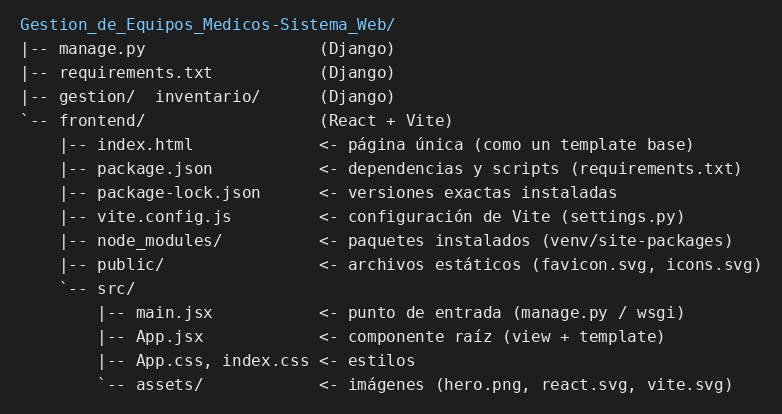

# Ejercicio 3 – Estructura del proyecto React (frontend)

## Qué hace cada pieza y su equivalente en Django

| Archivo | Con mis palabras | Equivalente en Django |
|---|---|---|
| `index.html` | Es la única página HTML que recibe el navegador. Casi está vacía: solo tiene un `

` (el hueco donde React dibujará todo) y una etiqueta `<script>` que carga `main.jsx`. | El template base (`base.html`): el cascarón HTML. La diferencia es que aquí el contenido no lo rellena el servidor, sino React en el navegador. |
| `src/main.jsx` | Es el punto de entrada de JavaScript. Busca el `#root` de `index.html` y le dice a React: "dibuja aquí el componente `<App />`". | `manage.py` / `wsgi.py`: lo primero que se ejecuta y que arranca toda la aplicación. |
| `src/App.jsx` | Es el componente raíz: una función que devuelve la interfaz (JSX, una mezcla de HTML y JavaScript) y maneja su estado (`useState`, el contador). Los demás componentes irán colgando de él. | Una vista junto con su template: la lógica y el HTML de lo que se muestra, juntos en un solo lugar. |
| `package.json` | Es la ficha del proyecto: nombre, dependencias (`react`, `react-dom`, `vite`…) y scripts (`npm run dev`, `npm run build`). | `requirements.txt`, con el extra de que también guarda los comandos (parecido a lo que `manage.py` ofrece). |
| `node_modules/` | Es la carpeta donde `npm install` descarga todos los paquetes (y los de sus dependencias). Es enorme, se puede regenerar y no se sube a Git (está en `.gitignore`). | El entorno virtual `venv/` (`site-packages`), donde `pip install` deja las librerías. |

Otros archivos: `package-lock.json` fija las versiones exactas instaladas; `vite.config.js` configura Vite (algo como `settings.py`); `public/` guarda estáticos servidos tal cual, como el favicon.

## Cómo se conectan
`index.html` (el navegador lo carga) → `<script src="/src/main.jsx">` → `main.jsx` monta `<App />` en `#root` → `App.jsx` dibuja la interfaz.

Nota: se exploró la carpeta generada en el ejercicio 2 (en la sesión, con `node_modules` de 22 paquetes de primer nivel, 64 MB). En tu PC aparece `node_modules/` tras ejecutar `npm install`.
