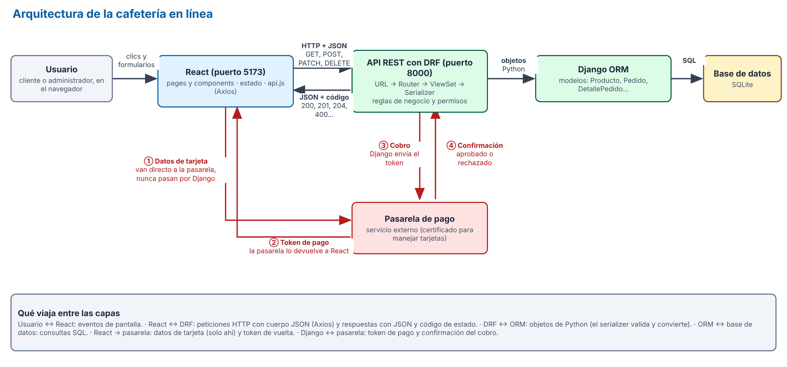
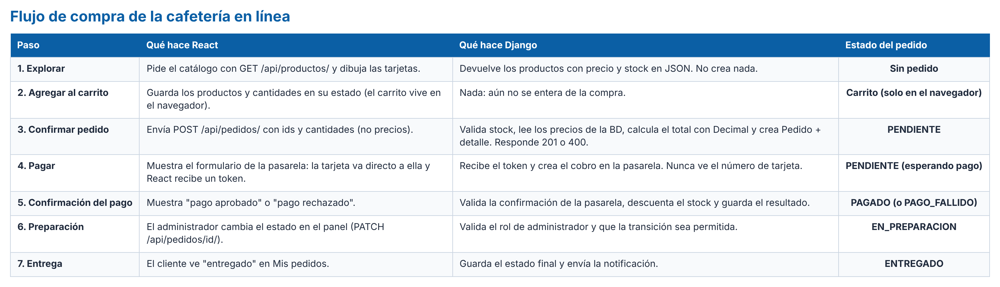

# Laboratorio 13 — Ejercicio 4: Describir el flujo de compra y la arquitectura

Caso: cafetería en línea (comercio B2C) con React como interfaz y Django + DRF como API.

## 1. Arquitectura

Capas y lo que viaja entre ellas:

| Entre | Qué viaja |
|---|---|
| Usuario ↔ React | Eventos de pantalla (clics, formularios). |
| React ↔ API REST (DRF) | Peticiones HTTP con cuerpo JSON (Axios) y respuestas con JSON y código de estado (200, 201, 204, 400…). |
| API ↔ Django ORM | Objetos de Python: el serializer valida y convierte. |
| ORM ↔ base de datos | Consultas SQL (SQLite). |
| React → pasarela de pago | Datos de la tarjeta (solo aquí) y el token que la pasarela devuelve. |
| Django ↔ pasarela de pago | Token de pago (cobro) y confirmación aprobado/rechazado. |

## 2. Flujo de compra

Estados del pedido: PENDIENTE → PAGADO (o PAGO_FALLIDO) → EN_PREPARACION → ENTREGADO. El carrito no es un pedido: solo existe en el navegador hasta que el cliente confirma.

## 3. Por qué el sistema no recibe el número de tarjeta

- **Seguridad:** si el número pasara por Django, quedaría en nuestros logs, memoria o base de datos, y una filtración expondría las tarjetas de los clientes.
- **Normativa (PCI DSS):** manejar datos de tarjeta exige certificaciones y auditorías costosas. La pasarela ya las tiene; nuestra app no.
- **Responsabilidad legal:** quien guarda la tarjeta responde ante el cliente y el banco si hay un robo. Con la pasarela, ese riesgo recae en ella.
- **Solución:** la tarjeta va directo del navegador a la pasarela, que devuelve un token de un solo uso. Django solo usa ese token para cobrar y recibe la confirmación; guarda el resultado del pago, no la tarjeta.

## Capturas

- `01_arquitectura.png` — diagrama de capas con el recorrido de la tarjeta, el token y la confirmación.
- `02_flujo_compra.png` — tabla de los 7 pasos (React / Django / estado del pedido).
