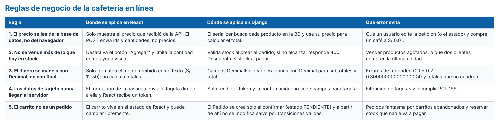

# Laboratorio 13 — Ejercicio 5: Reglas de negocio y errores comunes

Caso: cafetería en línea (React + Django/DRF).

## 1. Reglas de negocio

| # | Regla | React | Django | Error que evita |
|---|---|---|---|---|
| 1 | El precio se lee de la BD, no del navegador | Solo muestra el precio recibido; el POST envía ids y cantidades | El serializer busca cada producto y usa su precio para el total | Comprar un café a S/ 0.01 editando la petición |
| 2 | No se vende más de lo que hay en stock | Desactiva "Agregar" y limita la cantidad (ayuda visual) | Valida stock al crear el pedido (400 si no alcanza) y lo descuenta al pagar | Vender agotados o la última unidad a dos clientes |
| 3 | El dinero se maneja con Decimal, no con float | Solo formatea el monto como texto | DecimalField y operaciones con Decimal | Errores de redondeo (0.1 + 0.2 = 0.30000000000000004) |
| 4 | Los datos de tarjeta nunca llegan al servidor | La tarjeta va directo a la pasarela; React recibe un token | Solo recibe token y confirmación | Filtración de tarjetas e incumplir PCI DSS |
| 5 | El carrito no es un pedido | El carrito vive en el estado de React | El Pedido se crea al confirmar (PENDIENTE) y solo cambia por transiciones válidas | Pedidos fantasma y stock reservado sin pago |

## 2. ¿Por qué el stock no puede controlarse solo en React?

Todo lo que corre en React se ejecuta en el navegador del cliente, y el cliente controla ese navegador: puede abrir las herramientas de desarrollo, cambiar el estado, desactivar el JavaScript o enviar la petición con `curl` sin pasar por la pantalla. Si el único control es un botón deshabilitado, basta saltárselo para pedir 500 unidades de un producto que tiene 3.

Además, React solo conoce el stock del momento en que cargó la página. Si dos clientes ven "quedan 2" y ambos compran, ninguno de los dos navegadores sabe lo que hizo el otro; solo Django, que consulta la base de datos en el momento de la compra, ve el stock real y puede rechazar el segundo pedido con un 400.

Por eso el control en React es solo una ayuda para el usuario (mejor experiencia), y la regla real se valida en Django, que es la única capa que el cliente no puede modificar. Lo mismo vale para el precio y los permisos.

## Capturas

- `01_reglas_negocio.png` — tabla de las 5 reglas con dónde se aplican y qué error evitan.
