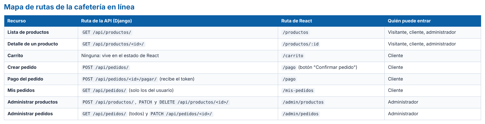

# Laboratorio 13 — Ejercicio 8: Mapa de rutas de la API y de React

## 1. Mapa de rutas



| Recurso | Ruta de la API (Django) | Ruta de React | Quién puede entrar |
|---|---|---|---|
| Lista de productos | `GET /api/productos/` | `/productos` | Visitante, cliente, administrador |
| Detalle de un producto | `GET /api/productos/<id>/` | `/productos/:id` | Visitante, cliente, administrador |
| Carrito | Ninguna: vive en el estado de React | `/carrito` | Cliente |
| Crear pedido | `POST /api/pedidos/` | `/pago` (botón "Confirmar pedido") | Cliente |
| Pago del pedido | `POST /api/pedidos/<id>/pagar/` (recibe el token) | `/pago` | Cliente |
| Mis pedidos | `GET /api/pedidos/` (solo los del usuario) | `/mis-pedidos` | Cliente |
| Administrar productos | `POST /api/productos/`, `PATCH` y `DELETE /api/productos/<id>/` | `/admin/productos` | Administrador |
| Administrar pedidos | `GET /api/pedidos/` (todos) y `PATCH /api/pedidos/<id>/` | `/admin/pedidos` | Administrador |

Las pantallas y roles salen de los ejercicios 2 y 3. Hoy solo existe `/api/productos/` (lectura, del Lab 12); las rutas de `pedidos` y de administración se implementan en las Semanas 14 a 16 y las rutas de React se crean en la Semana 14.

## 2. Servidores en marcha

```
python manage.py runserver      # Django en http://127.0.0.1:8000/
npm run build                   # genera frontend/dist sin errores
```

En la terminal de Django (`02_runserver.png`): `System check identified no issues`, `GET /api/productos/` responde **200** y `GET /api/pedidos/` responde **404**, porque esa ruta todavía no existe. Eso es lo esperado en esta etapa: el mapa fija el diseño y las rutas se van creando por semana. `npm run build` (`03_npm_build.png`) termina bien (102 módulos).

## 3. Ruta de la API frente a ruta de React

- Una **ruta de la API** (`/api/productos/`) vive en Django y responde con **datos en JSON**, sin diseño. La define `urls.py` con el router de DRF y la consume `api.js` por HTTP. Lleva un **método** (GET, POST, PATCH, DELETE) que dice qué se hace con el recurso, y devuelve un **código de estado**. Las protege Django: ahí se validan permisos y reglas.
- Una **ruta de React** (`/productos`) vive en el navegador y sirve para **mostrar una pantalla**. Cambiarla no recarga la página ni llama a Django por sí sola: React decide qué componente dibujar y recién ahí pide los datos a la API.

Una pantalla suele usar varias rutas de API (la página `/pago` llama a `POST /api/pedidos/` y luego al pago), y hay pantallas sin ruta de API propia (`/carrito`, que vive en el estado de React). Esconder una ruta de React a un rol (por ejemplo `/admin/productos`) solo mejora la experiencia: lo que realmente protege los datos es que Django rechace la ruta de la API con 401/403.

## Capturas

- `01_mapa_rutas.png` — tabla del mapa de rutas.
- `02_runserver.png` — `python manage.py runserver` y las peticiones.
- `03_npm_build.png` — `npm run build`.
