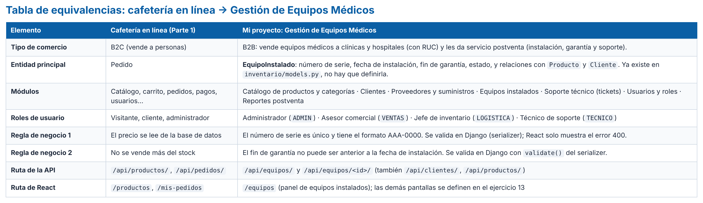
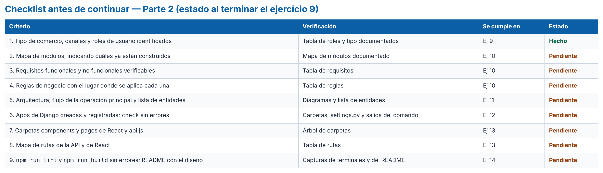

# Laboratorio 13 — Ejercicio 9: Identificar la entidad y los módulos del proyecto

Proyecto integrador: **Gestión de Equipos Médicos** (Django + DRF + React), el mismo repositorio de los laboratorios anteriores.

## 1. Tabla de equivalencias

| Elemento | Cafetería en línea (Parte 1) | Mi proyecto |
|---|---|---|
| Tipo de comercio | B2C (vende a personas) | B2B: vende equipos médicos a clínicas y hospitales (con RUC) y les da servicio postventa (instalación, garantía y soporte) |
| Entidad principal | Pedido | **EquipoInstalado**: número de serie, fecha de instalación, fin de garantía, estado; relaciones con `Producto` y `Cliente` |
| Módulos | Catálogo, carrito, pedidos, pagos, usuarios… | Catálogo de productos y categorías · Clientes · Proveedores y suministros · Equipos instalados · Soporte técnico (tickets) · Usuarios y roles · Reportes postventa |
| Roles | Visitante, cliente, administrador | Administrador (`ADMIN`), asesor comercial (`VENTAS`), jefe de inventario (`LOGISTICA`), técnico de soporte (`TECNICO`) |
| Regla 1 | El precio se lee de la BD | El número de serie es único y tiene formato AAA-0000 (validado en el serializer de Django) |
| Regla 2 | No se vende más del stock | El fin de garantía no puede ser anterior a la fecha de instalación (`validate()` del serializer) |
| Ruta de la API | `/api/productos/`, `/api/pedidos/` | `/api/equipos/`, `/api/equipos/<id>/` (también `/api/clientes/`, `/api/productos/`) |
| Ruta de React | `/productos`, `/mis-pedidos` | `/equipos`; las demás pantallas se definen en el ejercicio 13 |

## 2. ¿La entidad principal existe?

Sí. `EquipoInstalado` ya está en `inventario/models.py` (con los estados OPERATIVO, MANTENIMIENTO e INACTIVO) y se expone en `/api/equipos/` desde el Lab 12. Por eso no hace falta definir una entidad nueva. El resto de entidades existentes son `Cliente`, `Categoria`, `Proveedor`, `Producto`, `Suministro`, `Usuario`, `TicketSoporte` y `FichaTecnica`.

Por qué `EquipoInstalado` es la principal: es lo que la empresa vende y atiende después. Cada equipo conecta un producto con el cliente que lo recibió, y de él dependen la garantía y los tickets de soporte. Lo equivalente al pedido de la cafetería.

Las dos reglas elegidas ya están implementadas y probadas en el Lab 12 (`validate_numero_serie` y `validate`). En el ejercicio 10 se completan las cinco reglas del proyecto con el lugar donde se aplica cada una.

## 3. Checklist de la Parte 2

Con este ejercicio queda cumplido el criterio 1 (tipo de comercio, canales y roles). Los criterios 2 a 9 se completan en los ejercicios 10 a 14.

## Capturas

- `01_tabla_equivalencias.png` — tabla de equivalencias completa.
- `02_checklist_parte2.png` — checklist con el estado actual de cada criterio.
