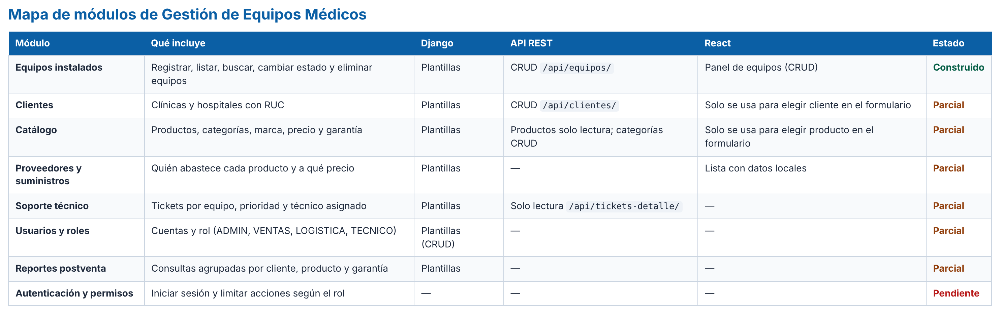
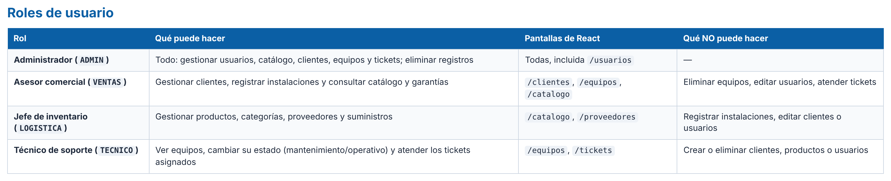
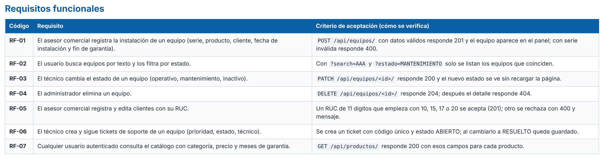
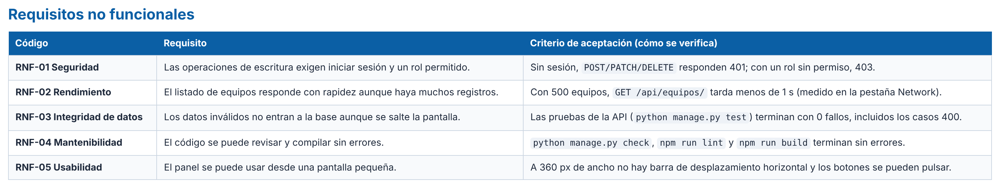
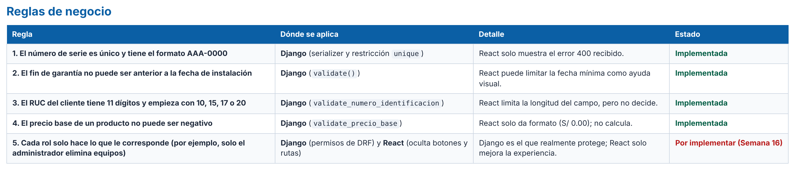

# Laboratorio 13 — Ejercicio 10: Diseñar módulos, requisitos y reglas

Proyecto: **Gestión de Equipos Médicos** (entidad principal: `EquipoInstalado`).

## 1. Mapa de módulos

| Módulo | Qué incluye | Django | API REST | React | Estado |
|---|---|---|---|---|---|
| Equipos instalados | Registrar, listar, buscar, cambiar estado y eliminar equipos | Plantillas | CRUD `/api/equipos/` | Panel de equipos (CRUD) | Construido |
| Clientes | Clínicas y hospitales con RUC | Plantillas | CRUD `/api/clientes/` | Solo para elegir cliente en el formulario | Parcial |
| Catálogo | Productos, categorías, marca, precio y garantía | Plantillas | Productos solo lectura; categorías CRUD | Solo para elegir producto en el formulario | Parcial |
| Proveedores y suministros | Quién abastece cada producto y a qué precio | Plantillas | — | Lista con datos locales | Parcial |
| Soporte técnico | Tickets por equipo, prioridad y técnico | Plantillas | Solo lectura `/api/tickets-detalle/` | — | Parcial |
| Usuarios y roles | Cuentas y rol | Plantillas (CRUD) | — | — | Parcial |
| Reportes postventa | Consultas agrupadas | Plantillas | — | — | Parcial |
| Autenticación y permisos | Iniciar sesión y limitar acciones por rol | — | — | — | Pendiente |

**Construido** = existe en Django, API y React. **Parcial** = existe solo una parte (por ejemplo, solo en plantillas de Django). **Pendiente** = no existe todavía. Esta clasificación sale de lo que hay hoy en el repositorio: el panel de React solo consume `/api/equipos/`, `/api/productos/` y `/api/clientes/`.

## 2. Roles

| Rol | Qué puede hacer | Pantallas de React | Qué NO puede hacer |
|---|---|---|---|
| Administrador (`ADMIN`) | Todo, incluida la gestión de usuarios y eliminar registros | Todas | — |
| Asesor comercial (`VENTAS`) | Clientes, registrar instalaciones, consultar catálogo y garantías | `/clientes`, `/equipos`, `/catalogo` | Eliminar equipos, editar usuarios, atender tickets |
| Jefe de inventario (`LOGISTICA`) | Productos, categorías, proveedores y suministros | `/catalogo`, `/proveedores` | Registrar instalaciones, editar clientes o usuarios |
| Técnico de soporte (`TECNICO`) | Ver equipos, cambiar su estado y atender sus tickets | `/equipos`, `/tickets` | Crear o eliminar clientes, productos o usuarios |

Los cuatro roles ya existen en el modelo `Usuario`. Los permisos y las pantallas por rol son un diseño propuesto: todavía no se aplican en el código.

## 3. Requisitos funcionales

| Código | Requisito | Criterio de aceptación |
|---|---|---|
| RF-01 | Registrar la instalación de un equipo | `POST /api/equipos/` válido → 201 y aparece en el panel; serie inválida → 400 |
| RF-02 | Buscar equipos por texto y filtrar por estado | `?search=` y `?estado=` listan solo los que coinciden |
| RF-03 | Cambiar el estado de un equipo | `PATCH /api/equipos/<id>/` → 200 y se ve sin recargar |
| RF-04 | Eliminar un equipo (administrador) | `DELETE` → 204; luego el detalle responde 404 |
| RF-05 | Registrar y editar clientes con su RUC | RUC válido → 201; RUC inválido → 400 con mensaje |
| RF-06 | Crear y seguir tickets de soporte | Ticket con código único y estado ABIERTO; al pasar a RESUELTO queda guardado |
| RF-07 | Consultar el catálogo con categoría, precio y garantía | `GET /api/productos/` → 200 con esos campos |

## 4. Requisitos no funcionales

| Código | Requisito | Criterio de aceptación |
|---|---|---|
| RNF-01 Seguridad | Las escrituras exigen sesión y un rol permitido | Sin sesión → 401; rol sin permiso → 403 |
| RNF-02 Rendimiento | El listado responde rápido con muchos registros | Con 500 equipos, `GET /api/equipos/` tarda menos de 1 s (pestaña Network) |
| RNF-03 Integridad | Los datos inválidos no entran a la base | `python manage.py test` termina con 0 fallos, incluidos los casos 400 |
| RNF-04 Mantenibilidad | El código se revisa y compila sin errores | `check`, `npm run lint` y `npm run build` sin errores |
| RNF-05 Usabilidad | El panel se usa desde una pantalla pequeña | A 360 px no hay scroll horizontal y los botones se pueden pulsar |

## 5. Reglas de negocio

| Regla | Dónde se aplica | Estado |
|---|---|---|
| 1. Número de serie único y con formato AAA-0000 | Django (serializer y `unique`); React solo muestra el 400 | Implementada |
| 2. El fin de garantía no es anterior a la instalación | Django (`validate()`); React puede limitar la fecha como ayuda | Implementada |
| 3. RUC de 11 dígitos que empieza con 10, 15, 17 o 20 | Django (`validate_numero_identificacion`); React limita la longitud | Implementada |
| 4. El precio base no puede ser negativo | Django (`validate_precio_base`); React solo da formato | Implementada |
| 5. Cada rol solo hace lo que le corresponde | Django (permisos de DRF) y React (oculta botones y rutas) | Por implementar (Semana 16) |

Criterio general: la regla se decide en Django, que es la capa que el usuario no puede modificar; React solo ayuda a mostrarla.

## Capturas

- `01_mapa_modulos.png`, `02_roles.png`, `03_requisitos_funcionales.png`, `04_requisitos_no_funcionales.png`, `05_reglas_negocio.png`.
