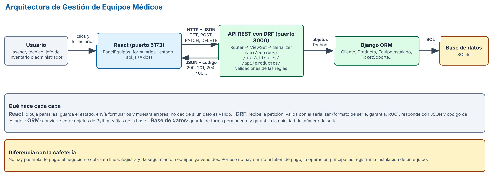
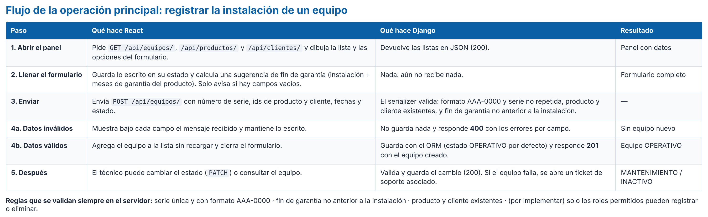
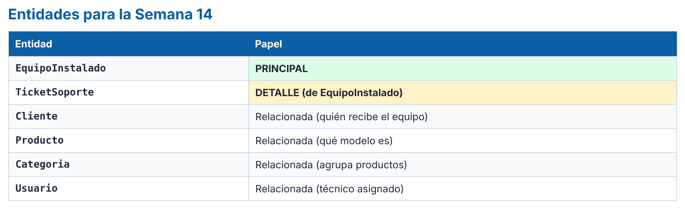

# Laboratorio 13 — Ejercicio 11: Arquitectura y flujo principal

Proyecto: **Gestión de Equipos Médicos**. Operación principal: **registrar la instalación de un equipo** (entidad `EquipoInstalado`).

## 1. Arquitectura

| Capa | Qué hace |
|---|---|
| Usuario | Asesor, técnico, jefe de inventario o administrador, desde el navegador. |
| React (5173) | Dibuja el panel y los formularios, guarda el estado y envía peticiones con `api.js` (Axios). No decide si un dato es válido. |
| API REST con DRF (8000) | Router → ViewSet → Serializer. Expone `/api/equipos/`, `/api/clientes/` y `/api/productos/`; valida las reglas y responde con JSON y código de estado. |
| Django ORM | Convierte entre objetos de Python y filas (`Cliente`, `Producto`, `EquipoInstalado`, `TicketSoporte`…). |
| Base de datos | SQLite; garantiza la unicidad del número de serie. |

A diferencia de la cafetería, **no hay pasarela de pago**: el negocio registra y da seguimiento a equipos ya vendidos, así que no hay carrito ni token de pago.

## 2. Flujo de la operación principal

| Paso | React | Django | Resultado |
|---|---|---|---|
| 1. Abrir el panel | `GET /api/equipos/`, `/api/productos/`, `/api/clientes/` y dibuja lista y opciones | Devuelve las listas (200) | Panel con datos |
| 2. Llenar el formulario | Guarda lo escrito y sugiere el fin de garantía (instalación + meses de garantía del producto); avisa solo si hay campos vacíos | Nada | Formulario completo |
| 3. Enviar | `POST /api/equipos/` con serie, ids de producto y cliente, fechas y estado | Valida: formato AAA-0000 y serie no repetida, producto y cliente existentes, garantía no anterior a la instalación | — |
| 4a. Inválido | Muestra bajo cada campo el mensaje recibido | No guarda y responde 400 con errores por campo | Sin equipo nuevo |
| 4b. Válido | Agrega el equipo a la lista sin recargar | Guarda con el ORM (estado OPERATIVO) y responde 201 | Equipo OPERATIVO |
| 5. Después | El técnico cambia el estado (`PATCH`) | Valida y guarda (200); si el equipo falla, se abre un ticket | MANTENIMIENTO / INACTIVO |

**Reglas validadas siempre en el servidor:** serie única y con formato AAA-0000; fin de garantía no anterior a la instalación; producto y cliente existentes; y, por implementar en la Semana 16, que solo los roles permitidos registren o eliminen.

Observación de diseño: hoy React calcula la sugerencia de `fin_garantia` (instalación + meses del producto) y Django solo comprueba que no sea anterior a la instalación. Una mejora posible es que Django calcule la garantía por sí mismo, para que el valor no dependa del navegador.

## 3. Entidades para la Semana 14

| Entidad | Papel |
|---|---|
| `EquipoInstalado` | **Principal** |
| `TicketSoporte` | **Detalle** de `EquipoInstalado` (un equipo tiene muchos tickets) |
| `Cliente` | Relacionada: quién recibe el equipo |
| `Producto` | Relacionada: qué modelo es |
| `Categoria` | Relacionada: agrupa productos |
| `Usuario` | Relacionada: técnico asignado al ticket |

Las entidades ya existen en `inventario/models.py` desde laboratorios anteriores; en la Semana 14 se revisan y se separan en sus apps.

## Capturas

- `01_arquitectura.png`, `02_flujo_operacion_principal.png`, `03_entidades_semana14.png`.
