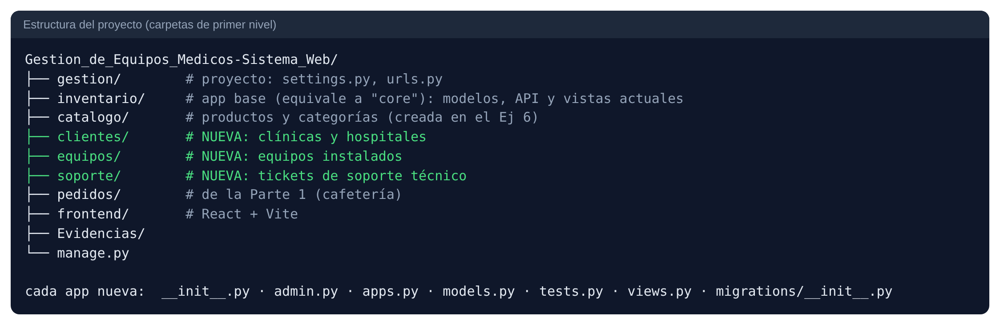
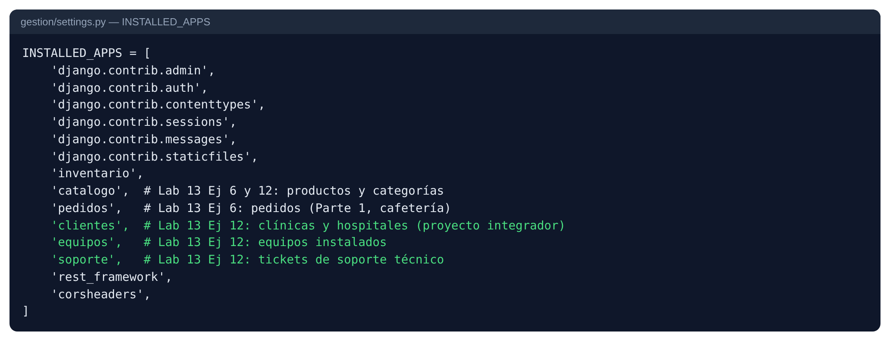
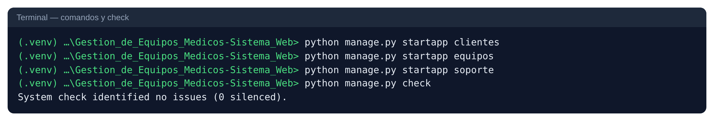

# Laboratorio 13 — Ejercicio 12: Crear las apps de Django del proyecto

Proyecto: **Gestión de Equipos Médicos**.

## 1. Una app por tema del negocio

| App | Tema | Origen |
|---|---|---|
| `inventario` | **App base** (equivale a la app `core` del enunciado): conserva los modelos, la API y las vistas actuales | Ya existía |
| `catalogo` | Productos y categorías | Creada en el Ej 6; se reutiliza |
| `clientes` | Clínicas y hospitales | **Nueva** |
| `equipos` | Equipos instalados (entidad principal) | **Nueva** |
| `soporte` | Tickets de soporte técnico (detalle del equipo) | **Nueva** |
| `pedidos` | Pedidos de la cafetería (Parte 1) | Creada en el Ej 6; no se usa en el proyecto |

Comandos:

```
python manage.py startapp clientes
python manage.py startapp equipos
python manage.py startapp soporte
```

Cada app queda con `__init__.py`, `admin.py`, `apps.py`, `models.py`, `tests.py`, `views.py` y `migrations/__init__.py`.

## 2. Estructura de carpetas



## 3. Registro en `gestion/settings.py`

```python
INSTALLED_APPS = [
    # ...
    'inventario',
    'catalogo',  # Lab 13 Ej 6 y 12: productos y categorías
    'pedidos',   # Lab 13 Ej 6: pedidos (Parte 1, cafetería)
    'clientes',  # Lab 13 Ej 12: clínicas y hospitales (proyecto integrador)
    'equipos',   # Lab 13 Ej 12: equipos instalados
    'soporte',   # Lab 13 Ej 12: tickets de soporte técnico
    'rest_framework',
    'corsheaders',
]
```



## 4. Verificación

```
python manage.py check
System check identified no issues (0 silenced).
```



Las apps están vacías (sin modelos), así que no hay migraciones nuevas. Los modelos `Cliente`, `Producto`, `EquipoInstalado` y `TicketSoporte` siguen en `inventario/models.py` y la API sigue funcionando igual.

## 5. Decisiones

- **`inventario` hace de `core`:** el proyecto ya tenía una sola app grande con todo, y no se renombró para no romper las migraciones, la API ni las pruebas existentes.
- **`pedidos` se conserva:** es la app de la Parte 1 (Ej 6) y su evidencia ya está entregada. No se usa en el proyecto integrador, porque en este negocio no hay carrito ni pedidos en línea.
- **Mover los modelos** de `inventario` a las apps nuevas es un cambio grande (migraciones de datos); se plantea para la Semana 14, cuando se modelen las entidades.

## Capturas

- `01_estructura_carpetas.png`, `02_settings_installed_apps.png`, `03_startapp_y_check.png`.
