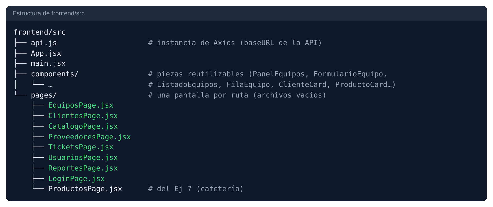
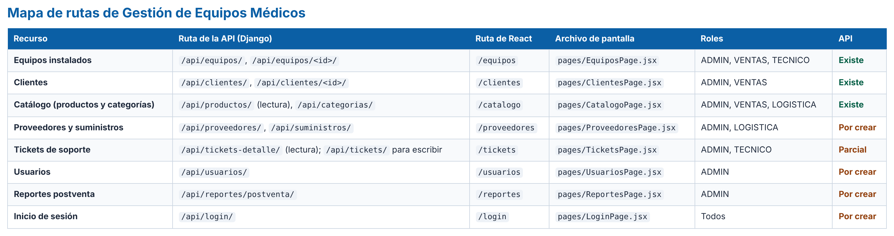
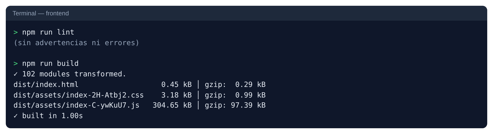

# Laboratorio 13 — Ejercicio 13: Estructura de React y mapa de rutas del proyecto

Proyecto: **Gestión de Equipos Médicos**.

## 1. Estructura de `frontend/src`

- **`components/`** ya existía (PanelEquipos, FormularioEquipo, ListadoEquipos, FilaEquipo, ClienteCard, ProductoCard…). Se conserva tal cual.
- **`api.js`** ya existía con la instancia de Axios (`baseURL` `http://localhost:8000/api/`, ajustada en el Ej 7). No se vuelve a crear.
- **`pages/`** se creó en el Ej 7 con `ProductosPage.jsx`. Ahora se agregan los archivos vacíos de las pantallas del panel, uno por módulo del Ej 10:

| Archivo | Pantalla |
|---|---|
| `EquiposPage.jsx` | Equipos instalados |
| `ClientesPage.jsx` | Clientes |
| `CatalogoPage.jsx` | Catálogo (productos y categorías) |
| `ProveedoresPage.jsx` | Proveedores y suministros |
| `TicketsPage.jsx` | Tickets de soporte |
| `UsuariosPage.jsx` | Usuarios y roles |
| `ReportesPage.jsx` | Reportes postventa |
| `LoginPage.jsx` | Inicio de sesión |

Los archivos están **vacíos a propósito**: nadie los importa todavía, así que no afectan al build. Se llenan en las Semanas 14 a 16. El panel actual (`PanelEquipos`) sigue funcionando desde `App.jsx`. `ProductosPage.jsx` es del Ej 7 (cafetería) y no pertenece a este proyecto.

## 2. Mapa de rutas

| Recurso | Ruta de la API | Ruta de React | Archivo | Roles | API |
|---|---|---|---|---|---|
| Equipos instalados | `/api/equipos/`, `/api/equipos/<id>/` | `/equipos` | `pages/EquiposPage.jsx` | ADMIN, VENTAS, TECNICO | Existe |
| Clientes | `/api/clientes/`, `/api/clientes/<id>/` | `/clientes` | `pages/ClientesPage.jsx` | ADMIN, VENTAS | Existe |
| Catálogo | `/api/productos/` (lectura), `/api/categorias/` | `/catalogo` | `pages/CatalogoPage.jsx` | ADMIN, VENTAS, LOGISTICA | Existe |
| Proveedores y suministros | `/api/proveedores/`, `/api/suministros/` | `/proveedores` | `pages/ProveedoresPage.jsx` | ADMIN, LOGISTICA | Por crear |
| Tickets de soporte | `/api/tickets-detalle/` (lectura); `/api/tickets/` para escribir | `/tickets` | `pages/TicketsPage.jsx` | ADMIN, TECNICO | Parcial |
| Usuarios | `/api/usuarios/` | `/usuarios` | `pages/UsuariosPage.jsx` | ADMIN | Por crear |
| Reportes postventa | `/api/reportes/postventa/` | `/reportes` | `pages/ReportesPage.jsx` | ADMIN | Por crear |
| Inicio de sesión | `/api/login/` | `/login` | `pages/LoginPage.jsx` | Todos | Por crear |

Los roles son los del Ej 10. La columna "API" indica qué rutas de la API existen hoy y cuáles faltan. Las rutas de React todavía no están activas: el proyecto no tiene un router y se definirán en la Semana 14 con las pantallas.

## 3. Verificación

`npm run lint` sin advertencias y `npm run build` correcto (102 módulos). `node_modules` y `dist` están en `.gitignore` y no se suben al repositorio.

## Capturas

- `01_arbol_frontend.png`, `02_mapa_rutas.png`, `03_lint_build.png`.
